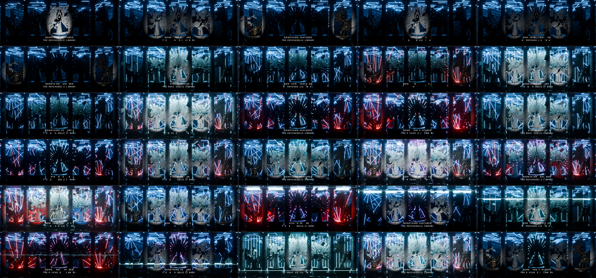
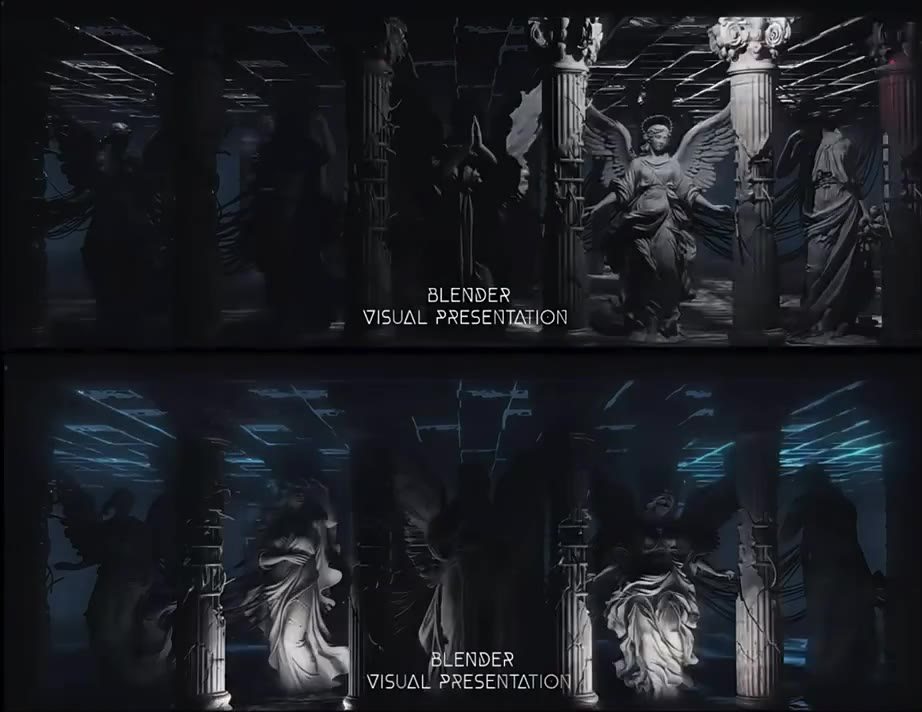

# Library Loop · 迷幻图书馆 10 秒循环

把朋友那条「Blender 打光」视频（`server/reference-videos/飞书20261112-062916.qt`）逆向出来，再升级成我们自己的版本：
**迷幻图书馆里，天使与魔鬼从书里杀出来**，频闪跟着音乐鼓点走，再加一整套激光。

整个场景由脚本生成：一条命令搭好布景、灯光、激光、镜头、标题和音乐；Tripo 做好的雕像放进文件夹再跑一条命令就替换进去。

| | |
| --- | --- |
| 预览片（云端渲的，占位模型） | `previz/library_loop_previz.mp4`（上下两联，带音乐）、`previz/library_loop_previz_hero.mp4`（只有主画面） |
| 参考片（裁好转正的 10 秒） | `reference/ref_loop.mp4` |
| 时长 / 帧率 / 画幅 | 300 帧 · 30 fps · 单联 1920×744（2.58:1，和参考片一致），上下两联 1920×1504 |
| 音乐 | `reference/audio_loop.wav`，参考片里那 10.03 秒，130 BPM |



---

## 1. 参考片逆向报告

以下都是从文件里量出来的，不是目测。

**文件本身**：37.5 秒的手机录屏（720×1562），内容是视频号里一条 **10.03 秒的循环**，录了三遍多。真正的画面是横的，约 1.295:1，由上下两联组成，每联约 2.58:1。



**布景**
- 6 根带凹槽的爱奥尼柱，隔出 5 个开间，每间一尊白色大理石雕像（左右是带翅膀的天使，中间那尊双手举过头顶）。
- 柱子上缠着黑色的线缆 / 藤蔓，后景是下垂的线。
- 天花板是一张发光灯管组成的矩形网格，有断线、有几根斜着掉下来的。
- 地面黑、亮、有倒影；空气里有一点蓝色的雾。

**上下两联是同一个机位、两套灯光**
- 下联（成片）：每尊雕像前面地上一盏**脚灯**往上打（裙摆最亮、头部最暗），硬切频闪；天花板网格是蓝色。
- 上联（素模 / 白光）：去色，一盏白色聚光灯**从右往左扫**过整排雕像，柱头被照亮。

**灯光节奏（逐帧测亮度得到，见 `reference/ref_brightness_per_frame.txt`）**

一个循环约 32 帧（1.07 秒），10 秒里重复 9 次多：

| 时刻 | 亮的是谁 |
| --- | --- |
| 0 | 中间一尊，瞬间亮起 |
| +0.18 s | 中间旁边两尊亮起，中间那尊还在衰减 |
| 约 +0.45 s | 全黑，只剩天花板 |
| +0.67 s | 最外侧两尊 |
| 约 +0.95 s | 全黑，然后重来 |

每次都是「瞬间到顶，0.25–0.3 秒衰减到黑」。上联那盏扫描灯每个循环扫 0.73 秒，歇 0.34 秒。

**标题**：画面下方居中两行细体字「BLENDER / VISUAL PRESENTATION」，字母随机掉字闪烁。

**音乐**：130 BPM，四四拍底鼓。鼓点在 0.42 s + 0.4615 s × k。

**一个关键发现**：灯光循环是 1.07 秒，而两拍是 0.92 秒——**参考片的灯并没有卡在鼓点上**，音乐是发视频号时后配的。我们的版本把每一次频闪都对到了鼓点上，这是最直接的「更上一层楼」。

**推测、没法从文件里确认的**：原片大概是 24 fps（录屏里大约每三帧重复一帧）；后期有辉光和一点暗角。

---

## 2. 我们的版本

### 概念：迷幻图书馆 ·「天上的战争」

> 在天上就有了争战。米迦勒同他的使者与龙争战。——启示录 12:7

五组雕像各自从一本摊开的巨书里冲出来，书垫在两本大部头上当基座：

| 位置 | 雕像 | 阵营 | 材质 |
| --- | --- | --- | --- |
| 3 中间 | 大天使米迦勒，双手举剑过顶，脚踩巨龙，翅膀全展 | 天 | 白色大理石 |
| 2 左内 | 吹号的天使，号角指向中间 | 天 | 白色大理石 |
| 4 右内 | 持矛的天使，向外侧刺出 | 天 | 白色大理石 |
| 1 左外 | 魔鬼从书页里爬出来，爪子伸向中间 | 地 | 黑色大理石带金纹 |
| 5 右外 | 坠落的路西法，抬臂挡脸，一边羽翼一边蝠翼 | 地 | 黑色大理石带金纹 |

中间那尊保留了参考片「双手举过头顶」的剪影。参考片「中间 → 内侧 → 外侧」的频闪波纹，在这里变成了**从天堂传到地狱**。

**图书馆布景**：每根柱子后面是一排通到底的书架，五个开间就是五条书架通道；后墙整面是书；地上散着书；雕像上方悬着一圈定格的飞书和书页。没被照到的雕像是压在蓝色书架前的黑色剪影。

### 激光设计

所有激光都放在**雕像身后**，给雕像勾边、当背景，而不是挡在前面。

| 编号 | 名字 | 位置 | 颜色 | 动作 | 意思 |
| --- | --- | --- | --- | --- | --- |
| L1 | 天花板网格 | 天花板 | 蓝 | 每半拍随机掉几组灯管，重拍闪一下 | 参考片原有的元素 |
| L2 | 天幕 | 雕像后一排 39 根竖直光束，分两组交错 | 青白 | 两组交替亮、16 分音符抖动 | 天堂 |
| L3 | 剪刀扇 | 每根柱子上方一个头，5 根光束扇形向下 | 深蓝 | 左右摆动，相邻两组错开，交叉成网 | 图书馆的「格」 |
| L4 | 地狱光 | 两侧魔鬼身后的地面，9 根向上炸开 | 红 | 快速摇摆，带红色轮廓光 | 地狱 |
| L5 | 荣光 | 米迦勒脑后，24 根放射光 + 两圈光环 | 青白，高潮时每拍换色（青 → 品红 → 金 → 蓝紫） | 持续旋转，重拍放大 | 巴洛克祭坛画的「荣光」，也是全片最迷幻的一处 |
| L6 | 扫描线 | 一片水平的薄光，穿过所有雕像 | 青白 | 第 5 小节从天花板降到地面 | 审判 |

### 10 秒的分镜（6 个小节）

| 小节 | 时间 | 名字 | 发生什么 |
| --- | --- | --- | --- |
| 1 | 0.0–1.8 s | 致敬 | 只有白光波纹和蓝网格，和参考片一样，只是卡在了拍子上 |
| 2 | 1.8–3.7 s | 书页翻开 | 波纹继续，激光一组一组醒过来：荣光、天幕、剪刀扇、地狱光 |
| 3 | 3.7–5.5 s | 对峙 | 正拍天堂（白），反拍地狱（红）；最后四分之一拍滚奏，接 3 帧全黑 |
| 4 | 5.5–7.3 s | 天上的战争 | 每个底鼓全场白闪；反拍左右红蓝对切，下一拍互换；荣光每拍换色 |
| 5 | 7.3–9.2 s | 审判 | 波纹反过来：地狱先亮，天使应，米迦勒收；扫描线下降 |
| 6 | 9.2–10.0 s | 归位 | 最大的一次全场闪，波纹向外散开、熄灭，接回第 1 帧 |

**循环无缝**：所有摆动都是 10 秒内的整数个周期，荣光转过的角度是 15° 的整数倍，结尾衰减到只剩网格再接回开头的重拍。

---

## 3. 分工：谁做什么

| 事情 | 云端（这里） | 你的电脑 |
| --- | --- | --- |
| 拆解参考片、量节奏、量鼓点 | 已完成 | |
| 概念、分镜、激光设计 | 已完成 | 看预览片，提修改意见 |
| Blender 场景脚本（布景 / 灯 / 激光 / 镜头 / 标题 / 合成） | 已完成，在 4.2、4.5、5.3 上跑通 | 运行一次生成 `.blend` |
| 低清预览片 | 已完成（CPU 渲染，占位模型） | |
| Tripo 提示词和批量脚本 | 已写好 | **生成模型**（要你的 Tripo 账号和额度）、挑最好的一版 |
| 把模型换进场景 | 脚本已写好并用替身模型测过 | 运行一次；朝向不对就改一个参数 |
| 成片渲染 | 云端没有显卡，做不了 | **GPU 渲染 300 帧** |
| 合成出片（带音乐的 MP4） | 脚本已写好并测过 | 运行一次 |
| 看着画面调亮度、雾、角度 | 可以改脚本参数，但看不到你的屏幕 | 本地 AI 配合 Blender 最顺手 |

如果你把 Tripo 的 API key 给云端（通过安全表单，不要贴在聊天里），生成模型这一步云端也能做，并且能用真模型重渲预览。

---

## 4. 本地操作手册

需要：Blender 4.2 或更新（测过 4.2 LTS、4.5 LTS、5.3）。下面的命令都在 `blender/library-loop/` 目录里执行；Windows 上把 `blender` 换成 `blender.exe` 的完整路径。

**第 1 步　生成场景**

```bash
blender -b -P scripts/build_scene.py -- --out library_loop.blend
```

打开 `library_loop.blend`，按空格播放，音乐和灯光是同步的。两个场景：`HERO`（成片）、`TOP`（上排白光扫描）。

**第 2 步　用 Tripo 做模型**

五尊雕像的提示词在 `tripo/assets.json`。两条路，选一条：

- **Tripo 网页版**：把每个 `prompt` 加上文件里的 `style_suffix` 贴进去生成，下载 GLB，按 `id` 改名放进 `assets/models/`，例如 `assets/models/hero_3_michael_dragon.glb`。雕像在 Blender 里会重新上大理石材质，所以**不需要贴图**，选无贴图更快更省。
- **Tripo API**（额度和网页版订阅是分开计费的）：

```bash
python scripts/tripo_batch.py --dry-run
```

```bash
python scripts/tripo_batch.py --variants 2
```

第一条只打印将要发送的内容，不花钱。第二条每尊出两版，约 30 额度一个（无贴图 10 + 精细几何 20），五尊两版约 300 额度。跑之前设置环境变量 `TRIPO_API_KEY`。

想更可控：先用出图工具按 `image_prompt` 出一张正面全身图，存成 `tripo/images/<id>.png`，脚本会自动改走图生 3D。

**第 3 步　把模型换进去**

```bash
blender -b library_loop.blend -P scripts/import_tripo.py
```

有几个文件就换几个，没有的保留占位模型，可以反复跑。如果雕像侧着或背对镜头，加 `-- --yaw 0`（或 90、180）；某一尊姿势左右反了，加 `-- --mirror 1`。

**第 4 步　渲染**

```bash
blender -b library_loop.blend -P scripts/render.py -- --scene HERO --out renders/hero
```

```bash
blender -b library_loop.blend -P scripts/render.py -- --scene TOP --out renders/top
```

可以中断后接着跑，已有的帧会跳过。只要主画面就不用渲 `TOP`。

**第 5 步　出片**

```bash
blender -b -P scripts/assemble.py -- --hero renders/hero --top renders/top --out out/library_loop.mp4
```

去掉 `--top` 就是只有主画面的版本；加 `--loops 6` 直接导出循环 6 遍的一分钟版。

### 给本地 AI 的一段话

可以直接贴给本地的 Claude Code / Cursor：

> 读 `blender/library-loop/README.md`。按第 4 节依次执行：生成场景、检查 `assets/models/` 里有哪些 Tripo 模型并运行 `import_tripo.py`、各渲一帧 HERO 的第 1、62、173、277 帧给我看。雕像朝向或大小不对就调 `--yaw` / `--mirror` 或 SLOT 空物体上的 `target_height`。画面太亮或太暗只改 `build_scene.py` 顶部 CONFIG 和 `animate_hero` 里 bake 的倍数，不要改节奏。我确认后再渲 300 帧并运行 `assemble.py`。

---

## 5. 常用参数

都在 `scripts/build_scene.py` 顶部：

| 参数 | 作用 |
| --- | --- |
| `RES` | 画幅。16:9 就改成 `(1920, 1080)` |
| `BPM`、`BEAT0` | 换音乐时改这两个（节拍速度、第一拍的时间），所有灯光跟着走 |
| `HAZE_DENSITY` | 雾的浓度，0 是关掉 |
| `TITLE_LINES` | 标题两行字 |
| `SLOTS` 里的 `height` | 每尊雕像的目标高度（米） |
| `COL_*` | 频闪、网格、天堂、地狱的颜色 |
| `animate_hero()` | 分镜本身，按小节写的，每行一个事件 |
| `bake_node(..., 倍数)` | 每组激光的亮度 |

命令行：`--engine EEVEE`（快很多）、`--quality previz`（低采样、半尺寸）、`--haze 0`。

---

## 6. 还没验证的事

- **EEVEE 的画面没看过**。云端没有显卡，预览和测试都是 Cycles。默认引擎设的是 Cycles，画面和预览片一致；`--engine EEVEE` 能跑但亮度、雾、辉光可能要调。
- **Tripo 批量脚本没有真的调用过接口**（云端没有 key）。它是按 2026-11-12 的官方文档（v3 接口）写的，`--dry-run` 测过，遇到意外的返回会原样打印并停下。
- **Tripo 模型的朝向**按文档写的「+X 朝前」处理，没有拿真模型验证，所以留了 `--yaw`。
- **「demon」之类的词会不会被 Tripo 审核拦下**不确定，魔鬼那尊准备了一条温和版提示词：`--moderated hero_1_demon_rising`。
- 预览片里的雕像是几何体拼的占位模型，只用来看构图、节奏和灯光。
- 画面里有大面积、每秒 4–8 次的频闪。如果在店里大屏上放，建议入口处提示，或者把 `KEY_W` 调低。
- 音乐来自参考片，按你说的非商用使用。

## 文件

```
scripts/build_scene.py     生成整个场景（唯一需要改的创作文件）
scripts/import_tripo.py    把 Tripo 模型换进五个位置
scripts/tripo_batch.py     调 Tripo API 批量生成（纯标准库）
scripts/render.py          渲 PNG 序列，可续渲
scripts/assemble.py        PNG + 音乐 → MP4（用 Blender 自带的剪辑器，不用装 ffmpeg）
tripo/assets.json          模型清单和提示词
reference/                 裁好的参考片、音乐、逐帧亮度数据、参考截图
assets/fonts/Jost-Light.ttf  标题字体（和官网 wordmark 同一款，OFL）
assets/models/             Tripo 的 GLB 放这里
previz/                    云端渲的预览
```
